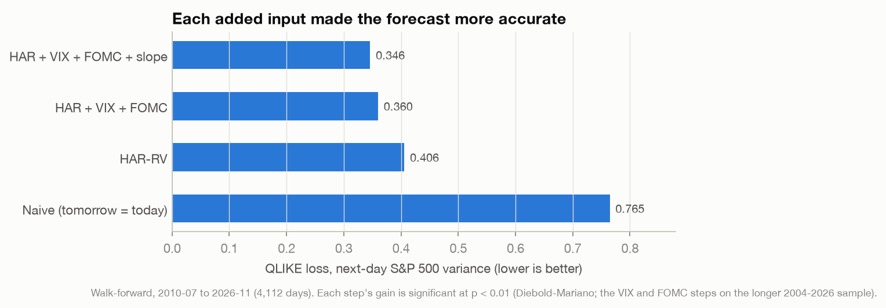
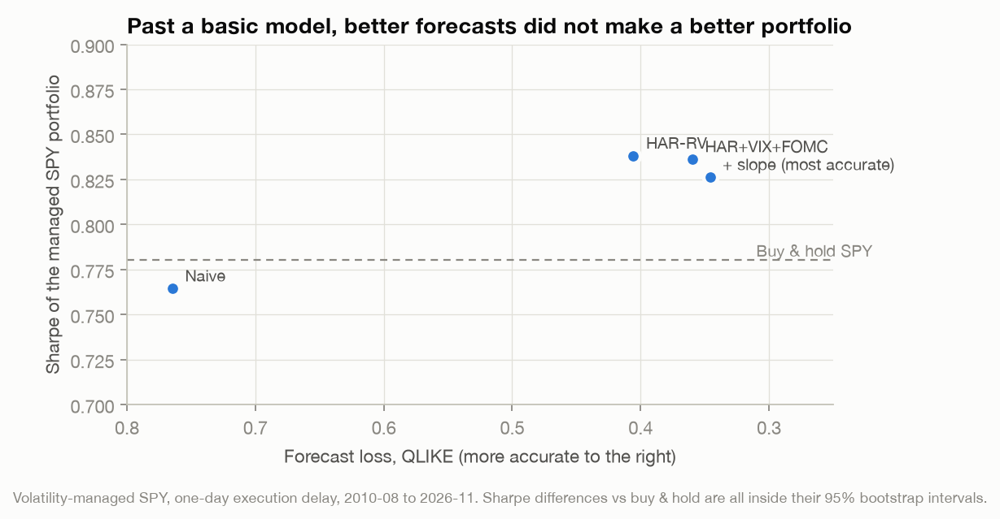
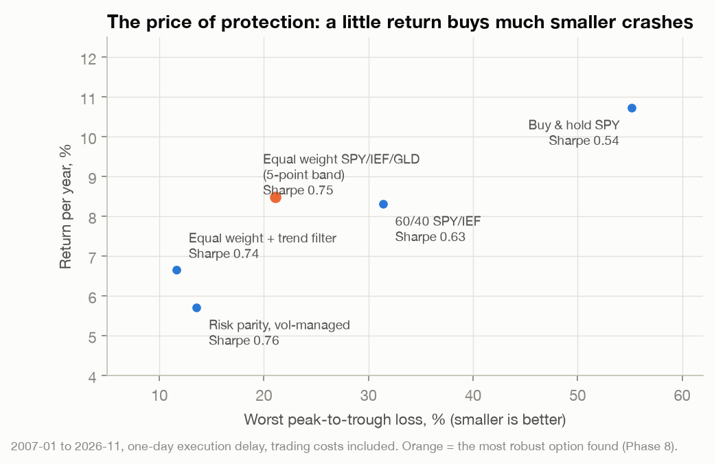
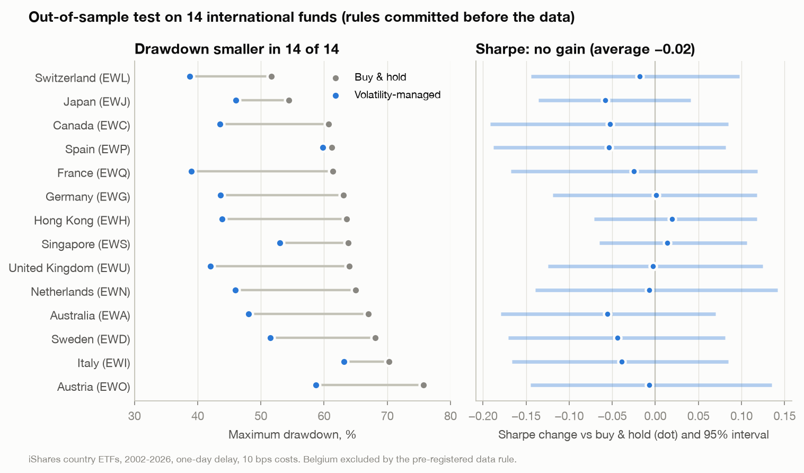
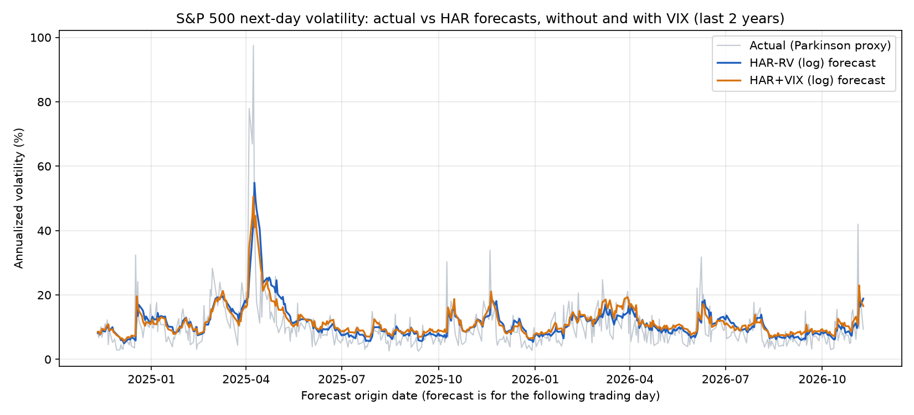
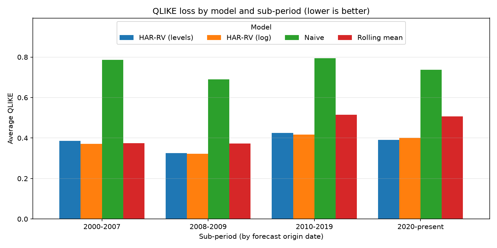

# Forecasting Market Volatility, and What It Is Actually Worth to an Investor

A research project in nine phases. I built walk-forward models that forecast next-day S&P 500 volatility, then asked whether those forecasts help an investor. The models forecast well. Better forecasts did not raise return per unit of risk, but they reliably reduced losses in crashes. Diversifying across stocks, bonds and gold did more for risk-adjusted return than any forecast.

The checks against fooling myself were:

- Every model is fit walk-forward, using only data known at the time.
- Trades are delayed by a day after the signal.
- Every backtest pays trading costs.
- Results come with bootstrap confidence intervals and a Sharpe ratio deflated for the number of strategies tried.
- The final test was pre-registered: its rules were committed to git before the data was downloaded.

Python (pandas, statsmodels, scipy, matplotlib), free Yahoo Finance data, 54 unit tests including no-look-ahead checks.

---

## Key findings

### 1. Next-day volatility is predictable, and each added input helped



A HAR-RV regression (daily, weekly and monthly realized variance) cuts forecast loss (QLIKE) by about half compared with "tomorrow = today". Adding the VIX, a scheduled-Fed-decision flag and the VIX term-structure slope each improved it further. Every step is statistically significant (Diebold-Mariano test, p < 0.01), and the slope model also won on a 2016+ holdout.

### 2. Past a basic model, better forecasts did not make a better portfolio



The trading rule holds SPY at full weight in normal markets and scales down when forecast volatility is above its typical level. It beat buy & hold on Sharpe with every model except the naive one. But the most accurate model gave the lowest Sharpe of the three HAR models, and every difference sits inside its 95% bootstrap interval. Forecast accuracy and trading value are different things.

### 3. Protection has a price, and diversification is the cheapest source



Over 2007 to 2026, an equal-weight SPY/IEF/GLD portfolio, rebalanced only when a weight drifts 5 points, earned 8.5% a year against 10.7% for SPY. Its worst loss was −21% against −55%, and its Sharpe ratio 0.75 against 0.54. Costs barely matter: the band trades about 12% of the portfolio a year.

The edge is not steady. It came from 2007 to 2012, SPY won 2013 to 2019, and 2020 onward was about even. Weighting by our volatility forecasts (risk parity) did not beat plain equal weight.

### 4. Out of sample, the volatility rule cut drawdowns everywhere but did not raise Sharpe



The same rule was run on 14 international country funds. The rules, fund list and pass test were committed before any of that data was downloaded. Results:

- **Maximum drawdown** fell in 14 of 14 funds. The average 2008-09 drawdown went from −61% to −43%.
- **Sharpe ratio** changed by −0.02 on average (95% interval −0.13 to +0.09).
- **Return** given up averaged about 0.9 points a year.

The pre-registered verdict is **crash insurance only**.

**Bottom line.** For an investor who wants a smoother ride, the evidence supports:

- a diversified core (equal-weight stocks, bonds and gold), and
- optional volatility scaling, priced at roughly 1 point of return a year for about a third smaller crashes.

It does not support a claim of beating the market. This is research on historical data, not investment advice.

---

## Catalogue of everything tried

Every idea tested, including the ones that failed. "Lag 1" means orders are placed one trading day after the signal.

| Phase | Question | What was tested | Result | Verdict |
|---|---|---|---|---|
| 1 | Can a simple model forecast next-day S&P 500 variance? | Naive, rolling mean, HAR-RV (levels and log), walk-forward from 2004 | HAR beats both baselines (DM −6 to −18) | **Kept**: HAR-RV (log) is the base model |
| 2 | Does information known at the close help? | VIX as implied variance; scheduled-FOMC-tomorrow flag | VIX cuts QLIKE 0.398 → 0.363; FOMC flag 0.363 → 0.360 (p = 0.003) | **Kept** (log form) |
| 2 | Levels HAR with VIX | Same inputs, unlogged | 5% of forecasts hit the 1e-8 floor in calm markets; QLIKE explodes | **Rejected**: log form only |
| 3 | Can the forecasts drive long/short volatility trades? | Walk-forward logistic signals on VXX/SVXY with confidence-based sizing | 5 years: $10k → $13.9k vs $17.7k holding SVXY and $16.9k SPY. 10 years: $14.6k vs $39.6k SPY, −67% max drawdown | **Rejected** |
| 4 | Does the VIX term structure help? | ln(VIX3M / VIX), chosen on 2010-2015, checked on 2016+ | QLIKE 0.360 → 0.346; DM −4.98 (all), −4.04 (holdout) | **Kept**: best forecaster |
| 4 | Other candidate inputs | Overnight gap, daily VIX change, down-day flag, SKEW, VVIX, day of week, options expiry, fitting directly on QLIKE, VIX9D slope | No holdout gain (VIX9D only on a short sample) | **Rejected** |
| 5 | Do the forecasts make money? | SPY weight = min(1, typical vol / forecast vol) for each model | Volatility down a third, drawdown −34% → −18%; Sharpe +0.03 to +0.08, all CIs include zero | Risk reduction only |
| 6 | Can we earn more than SPY? | Managed SPY with leverage dial k = 1.25 and 1.5 | k = 1.5: 17.5% vs 15.4% a year, smaller drawdown, same Sharpe | More return for more risk, needs leverage |
| 6 | Short-volatility carry | SVXY when VIX3M > VIX; 50/50 with SPY | Good with same-close orders; below SPY with a one-day delay | **Rejected** |
| 7 | Does diversifying beat timing? | SPY/IEF/GLD: 60/40, equal weight, risk parity (forecast-weighted), managed, levered | Equal weight Sharpe 0.77 vs SPY 0.54; risk parity no better than equal weight | **Kept**: equal weight |
| 8 | Is equal weight robust? | Realistic drift and costs; daily, monthly and 5-point-band rebalancing; 200-day trend filter; sub-periods; deflated Sharpe | Sharpe about 0.75 under every rule; edge concentrated in 2007-2012; trend filter halves drawdown but not Sharpe | **Kept**: 5-point band |
| 9 | Does the volatility rule work abroad (pre-registered)? | 15 iShares country funds (14 usable), same rule, 10 bps costs | Drawdown smaller 14 of 14; Sharpe −0.02 (CI −0.13 to +0.09) | **Crash insurance only** |

---

## Methods and safeguards

- **Variance proxy.** Parkinson range estimator: `RV_t = (ln(High_t / Low_t))^2 / (4 ln 2)`. It uses the day's whole price range, so it is far less noisy than a squared close-to-close return.
- **Walk-forward fitting.** The training window expands over time: at least 1,000 days for the S&P index and 500 for ETFs, with a refit every 21 days. A forecast made at day t never uses data after day t. Tests deliberately change future prices, VIX values and FOMC dates, and confirm that earlier forecasts and weights do not move.
- **Scoring.** QLIKE (the standard loss for variance forecasts, robust to the noisy proxy) and MSE. Significance uses Diebold-Mariano tests with Newey-West (HAC) standard errors.
- **Backtest realism.**
  - Orders execute one trading day after the signal.
  - Turnover pays costs: 2 bps for SPY and IEF, 3 bps for GLD, 5 to 10 bps for volatility products and country funds.
  - Cash earns T-bills, and borrowing costs T-bills + 0.5%.
  - From Phase 8 on, weights drift with prices between rebalances.
- **Uncertainty.** Every Sharpe difference has a 95% moving-block bootstrap interval (20-day blocks, 2,000 draws). The Phase 9 pooled interval resamples the same dates for every fund, so markets that crash together are not counted as independent evidence.
- **Multiple testing.** The deflated Sharpe ratio (Bailey and Lopez de Prado, 2014) is computed against the roughly 20 strategy variants tried, and against a conservative 50.
- **Pre-registration.** Phase 9's rules were committed (`1e353f7`) before its data was downloaded, and its results in a separate commit (`1187584`). Later code changes were to reporting only.

---

## Detailed results by phase

### Data

- **S&P 500 index (`^GSPC`)**: 2000-01-03 to 2026-11-10 (6,755 days).
- **Volatility indices**: VIX, VIX3M (from 2006-07) and VIX9D.
- **ETFs**: SPY, IEF, GLD, VXX, UVXY, SVXY, and 15 iShares country funds, all dividend-adjusted.
- **Cash**: the 13-week T-bill rate (`^IRX`).
- **Source**: everything comes from `yfinance` and is cached in `data/raw/`, which is not committed.
- **Validation**: no duplicate dates, a sorted index, no missing High/Low/Close, and High >= Low.
- **FOMC dates**: scheduled decision dates for 2000-2027 (223) come from federalreserve.gov via `scripts/fetch_fomc_dates.py`. Unscheduled meetings and calls are excluded because nobody knew about them in advance.

### Phases 1-2: HAR-RV, VIX and the FOMC flag

The inputs are all known at the close of day t:
- `rv_d`, `rv_w` and `rv_m`: today's variance and its 5- and 22-day averages.
- `vix_var` = (VIX / 100)^2 / 252, the VIX on the same daily-variance scale.
- `fomc_next` = 1 if tomorrow is a scheduled Fed decision day.

The log models are back-transformed with `exp(pred + 0.5 * residual variance)`. Levels forecasts are floored at 1e-8. The out-of-sample forecasts cover 5,733 days (2004-01-28 to 2026-11-09).

| Model | QLIKE | 2004-07 | 2008-09 | 2010-19 | 2020+ |
|---|---|---|---|---|---|
| Naive | 0.7694 | 0.7868 | 0.6895 | 0.7943 | 0.7463 |
| Rolling mean | 0.4788 | 0.3743 | 0.3737 | 0.5144 | 0.5175 |
| HAR-RV (levels) | 0.4009 | 0.3865 | 0.3252 | 0.4246 | 0.3969 |
| HAR-RV (log) | 0.3981 | 0.3710 | 0.3215 | 0.4173 | 0.4079 |
| HAR+VIX (log) | 0.3633 | 0.3429 | 0.3216 | 0.3746 | 0.3708 |
| HAR+VIX+FOMC (log) | **0.3595** | 0.3418 | 0.3205 | 0.3722 | 0.3625 |
| HAR+VIX (levels) | 76.47 | 19.46 | 0.3345 | 143.85 | 33.13 |
| HAR+VIX+FOMC (levels) | 78.78 | 18.45 | 0.3343 | 151.40 | 30.35 |

| Model A | Model B | Mean QLIKE diff | DM stat | p-value |
|---|---|---|---|---|
| HAR-RV (log) | Naive | −0.371 | −18.46 | < 1e-70 |
| HAR-RV (log) | Rolling mean | −0.081 | −8.08 | < 1e-15 |
| HAR+VIX (log) | HAR-RV (log) | −0.035 | −7.21 | < 1e-12 |
| HAR+VIX+FOMC (log) | HAR+VIX (log) | −0.004 | −2.99 | 0.003 |

- **MSE misleads here.** It is dominated by a few extreme days, which is why QLIKE is preferred.
- **VIX makes the monthly realized term redundant**: its coefficient falls to 0.005. On a Fed decision day, variance is about 1.6 times higher with the other inputs held fixed.
- **The levels VIX models fail on QLIKE**, though their MSE is fine. About 5% of their forecasts hit the floor in calm markets, where the linear forecast goes to zero or below. I did not change the floor after seeing this, because that would be tuning on the results.




### Phase 3: long/short volatility signals (rejected)

The tradable stand-ins are VXX (long volatility) and SVXY (short volatility). A walk-forward logistic regression combines five inputs:
- the gap between the VIX and our forecast (the variance risk premium)
- the VIX against its one-year mean
- VIX momentum
- the term structure
- the FOMC flag

Its output is the probability that volatility rises. Sizing is fixed in advance: full size at 65% confidence or more, half size at 55-65%, flat below 55%. Costs are 5 bps, with a one-day delay.

| Window | Strategy | Hold SVXY | Hold SPY | Strategy max drawdown |
|---|---|---|---|---|
| 5 years to 2026-11 | $13,855 (6.8%/yr, Sharpe 0.45) | $17,739 | $16,938 | −23% |
| 10 years to 2026-11 | $14,580 (3.9%/yr, Sharpe 0.29) | $7,339 | $39,648 | −67% |

The model was almost always short volatility, and its stated confidence was roughly honest: about 58% stated against 58% hit rate. Over 10 years, the February 2018 volatility spike (a −41% day for the strategy) dominates. VXX only exists from 2018, and SVXY changed from −1x to −0.5x leverage in 2018, so these numbers mix regimes. Treat them as unreliable.

### Phase 4: VIX term-structure slope

The new input is `vix_slope = ln(VIX3M / VIX)`. All models are scored on the same 4,112 days (2010-07 to 2026-11). The candidate was fixed in advance, chosen on 2010-2015 and checked on 2016+.

| Model | QLIKE (all) | 2010-2015 | 2016+ (holdout) |
|---|---|---|---|
| Naive | 0.7646 | 0.7739 | 0.7599 |
| HAR-RV (log) | 0.4056 | 0.3876 | 0.4147 |
| HAR+VIX+FOMC (log) | 0.3597 | 0.3409 | 0.3693 |
| HAR+VIX+FOMC+Slope (log) | **0.3460** | 0.3293 | 0.3544 |

Against HAR+VIX+FOMC, the slope model's DM statistic is −4.98 on all days and −4.04 on the holdout. Against plain HAR it is −7.48.

### Phase 5: volatility-managed SPY

`python -m src.volmanaged`. The weight is `min(1, c_t / sigma_t)`, where `sigma_t` is the model's forecast volatility and `c_t` is its expanding median. There is no leverage, the rest sits in T-bills, and costs are 2 bps. The sample is 4,092 days (2010-08 to 2026-11), with same-close orders.

| | CAGR | Volatility | Sharpe | Max drawdown | Worst day |
|---|---|---|---|---|---|
| Buy & hold SPY | 14.4% | 16.9% | 0.79 | −33.7% | −10.9% |
| Managed, HAR-RV (log) | 11.8% | 11.8% | 0.87 | −18.1% | −4.2% |
| Managed, HAR+VIX+FOMC+Slope (log) | 10.8% | 11.4% | 0.82 | −20.0% | −4.3% |

Sharpe differences against buy & hold range from +0.03 to +0.08, and every 95% interval includes zero. A one-day delay gives the same picture (`outputs/volmanaged_*_lag1.csv`).

### Phase 6: earning more than SPY

`python -m src.higher_return --lag 1`. Days: 2011-10 to 2026-11.

| | CAGR | Volatility | Sharpe | Max drawdown |
|---|---|---|---|---|
| Buy & hold SPY | 15.4% | 16.7% | 0.84 | −33.7% |
| Managed SPY, k = 1.5 (HAR-RV) | 17.5% | 19.3% | 0.85 | −27.6% |
| Managed SPY, k = 1.25 (HAR-RV) | 14.9% | 16.6% | 0.82 | −23.4% |
| SVXY in contango, else cash | 11.6% | 31.0% | 0.46 | −58.3% |
| 50% SPY + 50% SVXY in contango | 14.4% | 21.8% | 0.65 | −37.9% |

- **The leverage dial (k) adds return at the same Sharpe.** Exposure is capped at 2x, with borrowing at T-bills + 0.5%.
- **The longer 2004-2026 sample** compares k = 1.5 with SPY:
  - return: 13.3% against 10.7% a year
  - maximum drawdown: −39% against −55%
  - Sharpe: 0.65 against 0.54
- **The SVXY strategies only looked good with same-close orders.** With a one-day delay, both fall below SPY.

### Phase 7: multi-asset risk parity

`python -m src.multiasset --lag 1`. SPY, IEF and GLD each get their own HAR-RV forecast. Days: 2007-01 to 2026-11 (4,986).

| | CAGR | Volatility | Sharpe | Max drawdown | Sharpe 2008-09 |
|---|---|---|---|---|---|
| Buy & hold SPY | 10.8% | 19.6% | 0.54 | −55.2% | −0.17 |
| 60/40 SPY/IEF | 8.3% | 11.2% | 0.63 | −31.4% | −0.09 |
| Equal weight SPY/IEF/GLD | 8.7% | 9.4% | **0.77** | −20.7% | 0.34 |
| Risk parity (1 / forecast vol) | 6.4% | 6.6% | 0.74 | −17.7% | 0.66 |
| Risk parity, managed | 5.7% | 5.5% | 0.76 | −13.6% | 0.70 |
| Risk parity, levered to SPY's vol (cap 2x) | 9.9% | 12.5% | 0.70 | −34.1% | 0.64 |

- **Equal weight vs SPY:** +0.23 Sharpe, but the 95% interval (−0.11 to +0.56) includes zero.
- **Risk parity was bond-heavy:** it averaged about 57% in bonds, which earned little after 2020.
- **The levered version was capped:** it sat at the 2x limit about 90% of the time.
- **Average correlations:** SPY-IEF −0.29, SPY-GLD 0.04, IEF-GLD 0.28.

### Phase 8: robustness of equal weight

`python -m src.robustness --lag 1`. Weights drift between rebalances, and every trade pays costs.

| | CAGR | Sharpe | Max drawdown | Turnover / year |
|---|---|---|---|---|
| Buy & hold SPY | 10.7% | 0.54 | −55.2% | 0 |
| Equal weight, daily rebalance | 8.6% | 0.76 | −20.8% | 1.38 |
| Equal weight, monthly rebalance | 8.4% | 0.75 | −21.1% | 0.31 |
| Equal weight, 5-point band | 8.5% | 0.75 | −21.1% | 0.12 |
| Equal weight + 200-day trend filter | 6.7% | 0.74 | −11.6% | 1.85 |

| Sharpe | 2007-2012 | 2013-2019 | 2020+ | 2025+ (final check) |
|---|---|---|---|---|
| Buy & hold SPY | 0.17 | 1.07 | 0.65 | 0.70 |
| Equal weight, 5-point band | 0.86 | 0.73 | 0.72 | 0.95 |
| Difference (95% interval) | +0.69 (+0.11 to +1.29) | −0.34 (−1.09 to +0.45) | +0.07 (−0.49 to +0.56) | |

The deflated Sharpe ratio for equal weight is 0.985, or 0.975 assuming 50 trials. That means its Sharpe is very likely above zero after correcting for luck. It does not mean it beats SPY, which itself scores 0.89.

### Phase 9: pre-registered international test

`python -m src.international`. The funds are every developed-market fund from iShares' original 1996 country launch that still trades (Malaysia and Mexico are emerging markets and were left out). The rule is the same as Phase 5, with a one-day delay and 10 bps costs. A fund passes if its drawdown is smaller and its Sharpe is not lower.

| Fund | Sharpe B&H → managed | Max DD B&H → managed | Pass |
|---|---|---|---|
| Japan (EWJ) | 0.29 → 0.23 | −54% → −46% | |
| Australia (EWA) | 0.30 → 0.24 | −67% → −48% | |
| Hong Kong (EWH) | 0.34 → 0.36 | −64% → −44% | yes |
| Singapore (EWS) | 0.37 → 0.39 | −64% → −53% | yes |
| Canada (EWC) | 0.39 → 0.34 | −61% → −44% | |
| United Kingdom (EWU) | 0.29 → 0.29 | −64% → −42% | |
| Germany (EWG) | 0.32 → 0.32 | −63% → −44% | yes |
| France (EWQ) | 0.24 → 0.22 | −61% → −39% | |
| Switzerland (EWL) | 0.39 → 0.37 | −52% → −39% | |
| Netherlands (EWN) | 0.32 → 0.31 | −65% → −46% | |
| Italy (EWI) | 0.18 → 0.14 | −70% → −63% | |
| Spain (EWP) | 0.25 → 0.19 | −61% → −60% | |
| Sweden (EWD) | 0.33 → 0.29 | −68% → −52% | |
| Austria (EWO) | 0.22 → 0.22 | −76% → −59% | |
| Belgium (EWK) | excluded (371 zero-range days) | | |
| *SPY (in-sample reference)* | *0.50 → 0.59* | *−55% → −31%* | |

- **Overall:** 3 of 14 funds pass, and drawdown is smaller in 14 of 14. The pooled Sharpe difference is −0.02 (−0.13 to +0.09). By region: Asia-Pacific −0.02, Canada −0.05, Europe −0.02.
- **Costs are not the reason.** In a post-hoc check with zero costs, the pooled difference is only +0.005. The rule trades about 5.5 times the portfolio a year.
- **History is shorter than planned.** Data starts in 2000, not 1996, so evaluation starts in 2002 and mostly misses the 2000-02 crash. Several funds start in 2004-05 because of thin early trading.

---

## How to run

```bash
python3 -m venv .venv
source .venv/bin/activate              # Windows: .venv\Scripts\activate
pip install -r requirements.txt
python -m pytest                       # 54 tests

python -m src.run_phase1               # Phases 1-2 (add --refresh to re-download)
python -m src.backtest --lag 1 --years 10   # Phase 3
python -m src.run_phase4               # Phase 4
python -m src.volmanaged --lag 1       # Phase 5
python -m src.higher_return --lag 1    # Phase 6
python -m src.multiasset --lag 1       # Phase 7
python -m src.robustness --lag 1       # Phase 8
python -m src.international            # Phase 9
python -m src.make_charts              # README figures -> outputs/figures/
```

Results are written to `outputs/` as CSVs, and each phase also writes a JSON payload for the project's Google Sheet.

## Project structure

```
src/
  data.py, features.py, models.py, evaluate.py   data, HAR features, models, walk-forward + DM tests
  run_phase1.py, run_phase4.py                    forecasting experiments (Phases 1, 2, 4)
  backtest.py                                     Phase 3 volatility-product signals
  volmanaged.py, higher_return.py                 Phases 5-6 SPY strategies
  multiasset.py, robustness.py                    Phases 7-8 SPY/IEF/GLD portfolios
  international.py                                Phase 9 pre-registered test
  sheet_export.py, make_charts.py                 Google Sheet payloads, README figures
tests/                                            54 tests, incl. no-look-ahead checks
scripts/fetch_fomc_dates.py                       FOMC calendar from federalreserve.gov
data/events/                                      FOMC dates (data/raw/ is cached, not committed)
outputs/                                          result CSVs, charts, Sheet payloads
```

## Limitations

- **Parkinson is a proxy.** True realized variance needs intraday returns. Parkinson also ignores overnight gaps, so it understates variance on gap days.
- **One history.** Twenty to twenty-five years with a handful of crises (2008, 2020, 2022). Twenty years cannot statistically confirm a 0.2 Sharpe advantage.
- **Design choices were fixed but not unique.** Different training windows, refit intervals, HAR windows or floors could change the numbers.
- **The DM tests are approximate.** The models are nested, and several tests are run without a multiple-testing adjustment.
- **The log VIX model's slopes sum to 1.17.** The inputs are correlated and on different scales. I have not studied whether this matters in extreme markets.
- **Only scheduled FOMC meetings are flagged.** CPI and jobs-report dates are not used.
- **Backtest assumptions.** Costs and borrowing rates are simplified, and most retail leverage costs more than T-bills + 0.5%. Phases 7-8 rely on a period when bonds mostly hedged stocks (until 2022) and gold rallied after 2024.
- **Many strategies were tried.** About 20 variants were backtested. The deflated Sharpe ratio and the pre-registered Phase 9 address this, but the 2025+ final check is under two years long.
- **Nothing has been tested live.** All results are historical.

## Next steps

1. **Longer history.** Rebuild bond returns from yields (1962+) and add proxies for gold, to test the 1970s inflation and the 1987 and 2000-02 crashes.
2. **Live forward tracking.** Log each day's forecast and the strategy's target weights to build a genuinely out-of-sample record.
3. **Intraday realized variance.** Use it in place of the Parkinson proxy.
